<h1 align="center">华文书阁 | Huawen Shuge</h1>

<div align="center">
  
</div><br>

<p align="center">Chinese–Thai Translated Bookstore</p><br>

A web-based bookstore system for Chinese books translated into Thai.

This project focuses on System Analysis and Design, including system requirements, user roles, system workflows, database design, and web application development.

<br><h2>1. Project Overview</h2>

Huawen Shuge (华文书阁) is a web-based bookstore designed to provide a platform for customers to browse and purchase Chinese books translated into Thai.

The system also provides employee functions for managing books, customer orders, and user accounts.

The main purpose of this project is to apply System Analysis and Design concepts to a real-world web application, from requirement analysis and system design to implementation.

<br><h2>2. Project Objectives</h2>

Develop an online bookstore for Chinese books translated into Thai.

• Provide convenient book browsing and ordering functions for customers.

• Support book and order management for employees.

• Separate system access based on user roles.

• Design a structured database for storing and managing system information.

• Apply client-server architecture and API communication in web development.

<br><h2>3. System Analysis</h2>

This section describes the analysis and design of the system before and during implementation.

<h3>3.1 Problem Statement</h3>

Traditional book purchasing may require customers to visit a physical bookstore or contact sellers directly to check book information and availability.

The system aims to provide a centralized platform where customers can browse books, manage their shopping activities, and track orders.

For employees, the system provides tools to manage book information and process customer orders more systematically.

<h3>3.2 System Actors</h3>

The system consists of the following actors:

| Actor | Description |
| :--- | :--- |
| **Guest** | Users who visit the website without logging in. |
| **Customer** | Users who can manage their profiles, browse books, create orders, and track their orders. |
| **Staff** | Employees who manage books and process assigned orders. |
| **Manager** | Users with employee-level management permissions. |
| **Admin** | Users who manage accounts and user roles. |

<h3>3.3 Functional Requirements</h3>

<h4>Customer Functions</h4>

• Register a new account.

• Log in and log out.

• View and edit personal information.

• Browse available books.

• View book details.

• Add books to the wishlist.

• Manage shopping activities.

• Create orders.

• Upload payment slips.

• View order history and track order status.

<h4>Employee Functions</h4>

• View book information.

• Add new books.

• Edit book information.

• Delete books.

• View customer orders.

• View order details.

• Assign orders to employees.

• Update order status.

<h4>Manager and Admin Functions</h4>

• Access employee management functions.

• View account information.

• Manage user roles according to permissions.

<h3>3.4 Diagram</h3>

## System Design Diagrams

View the complete system design diagrams in the document below.

[](https://github.com/SmileCat42/HuawenShuge/raw/master/System%20Analysis.pdf)

<h4>Use Case Diagram</h4>

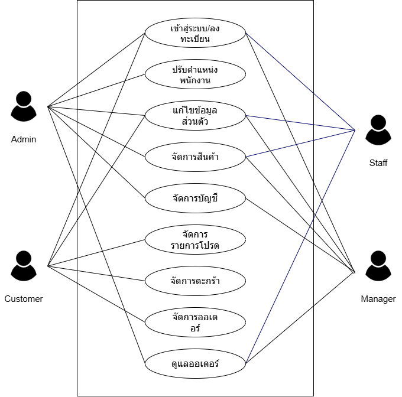

<h4>Use Case Description</h4>

Example Create Order and Payment


<h4>Sequence Diagram</h4>

Example Create Order and Payment

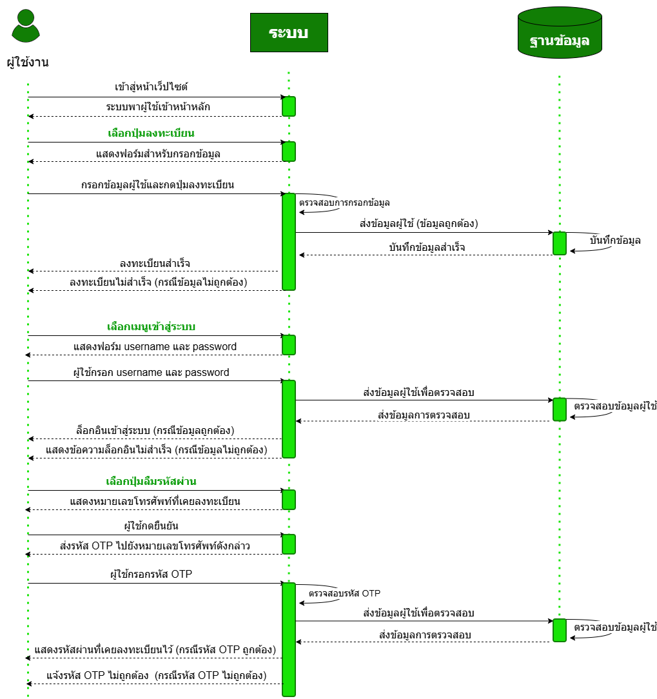

<h4>Activity Diagram</h4>

Example Create Order and Payment

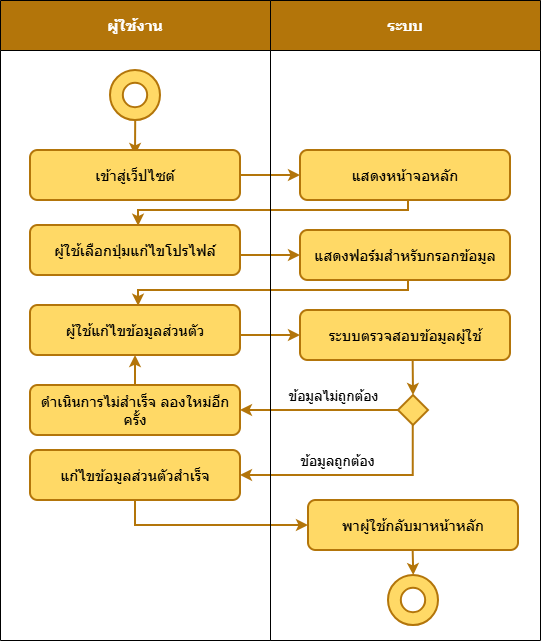

<h3>3.5 System Workflow</h3>

The system uses a client-server architecture.

The user interacts with the Frontend through the website.

Frontend sends an HTTP Request to the specified API endpoint.

Backend receives the request and processes it according to the HTTP Method and endpoint.

Backend communicates with PostgreSQL to retrieve or modify data.

Backend sends an HTTP Response back to Frontend.

Frontend displays the returned data to the user.

<h3>3.6 System Architecture</h3>

flowchart TD

A[User / Actor] --> B[Frontend]
    
B --> C[API Request]
    
C --> D[Backend - Express.js]
    
D --> E[PostgreSQL Database]
    
E --> D
    
D --> F[API Response]
    
F --> B
    
B --> G[Display Information]

<br><h2>4. System Implementation</h2>

<h3>4.1 Development Technologies</h3>

## Technology Stack

| Component | Technology |
| :--- | :--- |
| **Frontend** | HTML, JavaScript, Tailwind CSS |
| **Backend** | Node.js, Express.js, TypeScript |
| **Database** | PostgreSQL |
| **API Communication** | HTTP / Fetch API |
| **Development Environment** | Visual Studio Code |
| **Version Control** | Git and GitHub |

<h3>4.2 Frontend Implementation</h3>

The Frontend is responsible for displaying information and handling user interactions.

The website uses JavaScript Events to control interactive elements and panels. Some panels are initially hidden and become visible when users select the corresponding functions.

The interface also displays different functions according to the user's role.

<h3>4.3 Backend Implementation</h3>

The Backend is developed using Node.js and Express.js.

It provides API endpoints for handling requests from the Frontend.

Examples of API endpoints:

## API Endpoints

| Method | Endpoint | Description |
| :--- | :--- | :--- |
| `GET` | `/book` | Retrieve all books. |
| `GET` | `/book/:id` | Retrieve a specific book. |
| `POST` | `/book` | Add a new book. |
| `PUT` | `/book/:id` | Update book information. |
| `DELETE` | `/book/:id` | Delete a book. |
| `POST` | `/login` | Authenticate a user. |
| `POST` | `/order` | Create a new order. |
| `GET` | `/order/:id` | Retrieve order details. |

<h3>4.4 Database Implementation</h3>

PostgreSQL is used to store and manage system data.

The Backend uses the pg library to communicate with the database and execute SQL queries.

<h3>4.5 User Interface</h3>

The website provides different interfaces according to the user's role and available functions.

Main interfaces include:

• Home Page

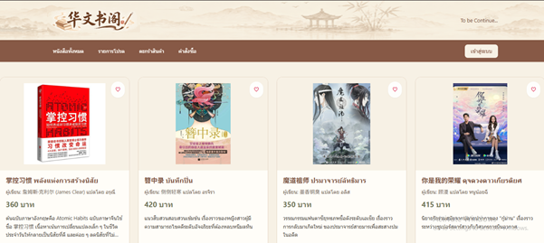

• Login

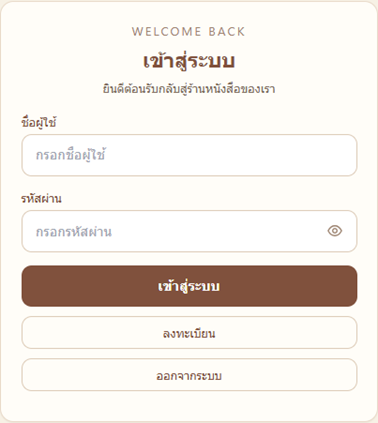

• Register

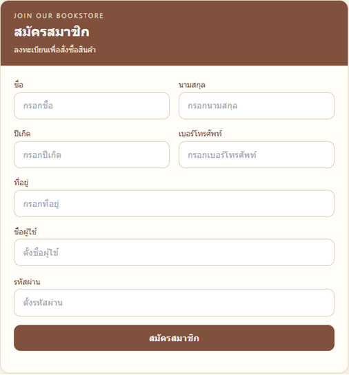

• Account Management

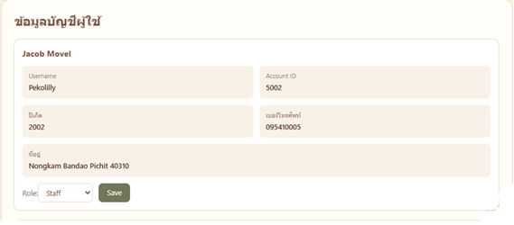

• Profile

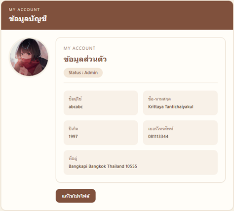

• Products

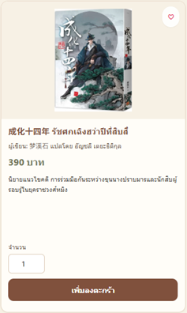

• Wishlist

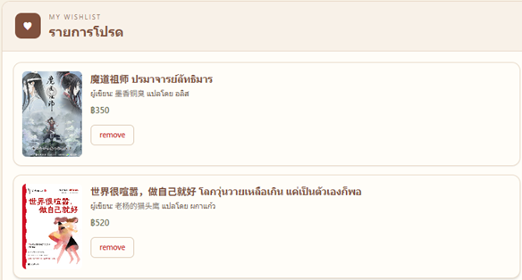

• Shopping Cart

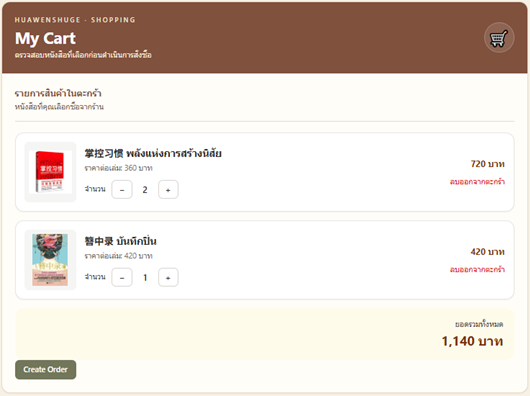

• Customer Order Management

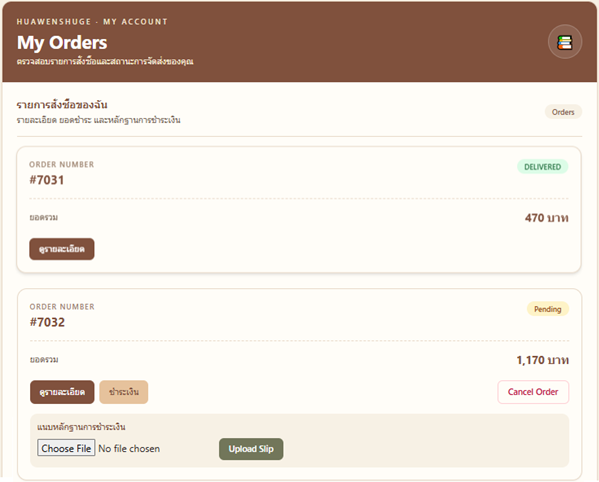

• Order Tracking

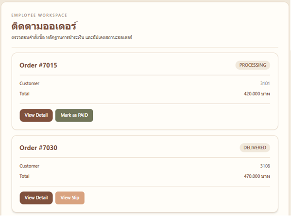

<br><h2>5. Project Structure</h2>

```text
HuawenShuge/
│
├── frontend/               # Client-side application (HTML, JS, Tailwind CSS)
│   ├── index.html
│   ├── script.js
│   ├── api.js
│   ├── package.json
│   └── images/
│
├── backend/                # Server-side REST API (Node.js, Express, TypeScript)
│   ├── src/
│   │   ├── index.ts
│   │   └── db.ts
│   └── package.json
│
├── docs/                   # System architecture and UML diagrams
│   └── diagrams/
│       ├── use-case-diagram.png
│       ├── er-diagram.png
│       └── class-diagram.png
│
└── README.md
```
<br><h2>6. Installation and Setup</h2>

<h3>Prerequisites</h3>

• Node.js

• PostgreSQL

• npm

• Git

<h3>Clone Repository</h3>

git clone https://github.com/SmileCat42/HuawenShuge.git

cd HuawenShuge

<h3>Database Setup</h3>

1. Install and start PostgreSQL.

2. Create a database named HuawenShuge.

3. Prepare the required database tables.

4. Configure the database connection in the Backend.

<h3>Frontend Setup</h3>

cd frontend

npm install

npm run dev

<h3>Backend Setup</h3>

cd backend

npm install

<br>Configure the TypeScript execution/build command according to the project environment before starting the Backend server.

<br>The Backend API is configured to use:

<br>http://localhost:3000

<br>The Frontend development server uses:

<br>http://localhost:5173

<h2>7. Conclusion</h2>

Huawen Shuge demonstrates the application of System Analysis and Design concepts in developing a web-based bookstore.

<br>The project covers system requirement analysis, actor identification, functional design, database design, user interface development,

API communication, and database integration.

<br>Through this project, the development process provides practical experience in connecting system design concepts with actual software

implementation.
