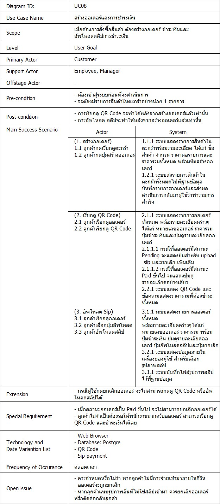

<h1 align="center">华文书阁 | Huawen Shuge</h1>

  

 

Chinese–Thai Translated Bookstore
 

A web-based bookstore system for Chinese books translated into Thai.

This project focuses on System Analysis and Design, including system requirements, user roles, system workflows, database design, and web application development.

 <h2>1. Project Overview</h2>

Huawen Shuge (华文书阁) is a web-based bookstore designed to provide a platform for customers to browse and purchase Chinese books translated into Thai.

The system also provides employee functions for managing books, customer orders, and user accounts.

The main purpose of this project is to apply System Analysis and Design concepts to a real-world web application, from requirement analysis and system design to implementation.

 <h2>2. Project Objectives</h2>

Develop an online bookstore for Chinese books translated into Thai.

• Provide convenient book browsing and ordering functions for customers.

• Support book and order management for employees.

• Separate system access based on user roles.

• Design a structured database for storing and managing system information.

• Apply client-server architecture and API communication in web development.

 <h2>3. System Analysis</h2>

This section describes the analysis and design of the system before and during implementation.

<h3>3.1 Problem Statement</h3>

Traditional book purchasing may require customers to visit a physical bookstore or contact sellers directly to check book information and availability.

The system aims to provide a centralized platform where customers can browse books, manage their shopping activities, and track orders.

For employees, the system provides tools to manage book information and process customer orders more systematically.

<h3>3.2 System Actors</h3>

The system consists of the following actors:

| Actor | Description |
| :--- | :--- |
| **Guest** | Users who visit the website without logging in. |
| **Customer** | Users who can manage their profiles, browse books, create orders, and track their orders. |
| **Staff** | Employees who manage books and process assigned orders. |
| **Manager** | Users with employee-level management permissions. |
| **Admin** | Users who manage accounts and user roles. |

<h3>3.3 Functional Requirements</h3>

<h4>Customer Functions</h4>

• Register a new account.

• Log in and log out.

• View and edit personal information.

• Browse available books.

• View book details.

• Add books to the wishlist.

• Manage shopping activities.

• Create orders.

• Upload payment slips.

• View order history and track order status.

<h4>Employee Functions</h4>

• View book information.

• Add new books.

• Edit book information.

• Delete books.

• View customer orders.

• View order details.

• Assign orders to employees.

• Update order status.

<h4>Manager and Admin Functions</h4>

• Access employee management functions.

• View account information.

• Manage user roles according to permissions.

<h3>3.4 Use Case Diagram</h3>

The Use Case Diagram describes the interactions between system actors and the functions available to them.

<h4>Example Use Case Diagram</h4>

<h4>Example Use Case Description</h4>

<h3>3.5 System Workflow</h3>

The system uses a client-server architecture.

The user interacts with the Frontend through the website.

Frontend sends an HTTP Request to the specified API endpoint.

Backend receives the request and processes it according to the HTTP Method and endpoint.

Backend communicates with PostgreSQL to retrieve or modify data.

Backend sends an HTTP Response back to Frontend.

Frontend displays the returned data to the user.

<h3>3.6 System Architecture</h3>

flowchart TD

A[User / Actor] --> B[Frontend]
    
B --> C[API Request]
    
C --> D[Backend - Express.js]
    
D --> E[PostgreSQL Database]
    
E --> D
    
D --> F[API Response]
    
F --> B
    
B --> G[Display Information]
